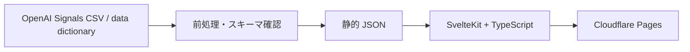

# アーキテクチャ方針

## 採用方針

- **UI / アプリ**: SvelteKit + TypeScript
- **ホスティング**: Cloudflare Pages
- **配信**: 原則静的生成・静的配信
- **データ**: 公式 CSV を前処理し、ダッシュボードで必要な粒度の JSON を出力
- **DB**: MVP では導入しない

この構成により、公開集計を表示するだけの初期版でサーバー側の状態管理を避け、更新・再現性・費用を単純に保ちます。

## データフロー

1. OpenAI の公式 CSV ZIP とデータ辞書を取得する。
2. リリース版、取得日、ファイル名、ヘッダー、期間、ライセンス情報を記録する。
3. MVP に必要な列とカテゴリに絞り、CSV から JSON を生成する。
4. 生成物を SvelteKit の静的アセットとしてビルド・配信する。
5. 画面は JSON を読み、期間・国・活動・トピックの選択に応じて表示する。



## データ前処理（フェーズ1で実装）

```
data/
  source.json                 固定するリリース版・取得日・公式 URL・SHA-256・帰属
  reference/iwa-labels.csv    IWA ID、データ辞書の英語ラベル、日本語表示名
  raw/                        公式 ZIP・辞書・展開 CSV（git 管理外。data:fetch で再取得）
  processed/<release>/        生成 JSON（git 管理し、ビルドではこれを読む）
scripts/data/
  datasets.ts                 公式 CSV と生成データセットの対応・分母・許容差
  fetch.ts / build.ts / verify.ts / extract-iwa-labels.ts
```

| コマンド | 内容 |
|---|---|
| `npm run data:fetch` | 公式 ZIP と辞書を取得し、`source.json` の SHA-256 と照合して展開。不一致なら停止 |
| `npm run data:build` | ヘッダー・値の形式・キー重複・構成比合計を検証し、JSON を生成 |
| `npm run data:verify` | 全行の値の一致、行数、期間、カテゴリ、日本のカバレッジ、ラベル、manifest を確認 |
| `npm run data` | 上記3つを順に実行 |
| `npm run data:labels -- <txt>` | `pdftotext -layout` で変換した辞書から IWA 英語ラベルを更新（日本語名は保持） |

スクリプトは Node.js 22.18 以降の型除去機能で TypeScript を直接実行します。

### 生成データセット

| ファイル | 元 CSV | 内容 |
|---|---|---|
| `iwa-by-country-quarter.json` | IWA 国別四半期 | 国、四半期、IWA 165分類の構成比。global なし |
| `work-share-by-month.json` | 仕事関連 global / 国別 | global / 国、月、`work_related` の構成比 |
| `work-topic-by-month.json` | トピック×仕事関連 global / 国別 | global / 国、月、`work_related`、トピックの構成比 |
| `work-intent-by-month.json` | Ask/Do/Express×仕事関連 global / 国別 | global / 国、月、`work_related`、Ask/Do/Express の構成比 |
| `country-rank-by-quarter.json` | 国別四半期順位 | 国、四半期、人口当たりメッセージ量の順位（補足指標） |
| `iwa-labels.json` | `iwa-labels.csv` | 生成データに含まれる IWA の英語ラベルと日本語表示名 |
| `data-manifest.json` | `source.json` ほか | 版、取得日、出典、帰属表示、各データセットの期間・行数・合計範囲・日本のカバレッジ |

JSON の構造は [データソース](data-sources.md#生成-json-の構造) を参照してください。グローバル IWA データを派生 JSON で作らない。JSON 変換はキーや値を保ち、実際の分母が変わる再集計をしません。

## 画面（フェーズ2で実装）

| パス | 内容 |
|---|---|
| `/` | 概要。日本の最新の仕事関連比率、最多トピック、人口当たり順位、IWA 上位5 |
| `/activities` | 日本の IWA 四半期ランキング（検索・全件表示）、選択した活動の推移と順位。`?iwa=<ID>` で活動を指定できる |
| `/usage` | 日本と世界の仕事関連比率の推移、トピック・Ask/Do/Express の構成、トピック別の推移 |
| `/compare` | 日本・比較国（最大2か国）・世界の月次比較、日本と比較国の IWA 比較、日本の順位。`?c=US,KR` で国を指定できる |
| `/about` | 出典、指標の意味、制約、ライセンス、推奨引用 |

- 全ページを `@sveltejs/adapter-static` でプリレンダーし、`build/` に出力する。Cloudflare Pages ではビルドコマンド `npm run build`、出力ディレクトリ `build` を指定する。
- ページのデータはビルド時に `src/lib/server/data.ts` が `data/processed/<release>/` から読み、必要な地域・区分（仕事関連 `work_related=1`）だけをページに埋め込む。
- 比較国のデータは、プリレンダーした `/data/monthly/<地域>.json` と `/data/iwa/<国>.json` から、選ばれたときだけ取得する。
- グラフは依存ライブラリを使わず、Svelte と SVG / HTML で描く（`src/lib/components/`）。
- OGP・Twitter カードは `src/lib/components/Seo.svelte` で全ページに出力する。画像は `static/og-image.jpg`（1200×630）。OGP の画像と URL は絶対 URL が必要なため、公開ドメイン `https://signals.tariki-code.tokyo` を `vite.config.ts` の既定値とし、環境変数 `PUBLIC_SITE_URL` で上書きできるようにしている。

## 更新と再現性

- CSV の列名・値の追加や削除、期間延長、リリース更新を検知する。`data:fetch` は SHA-256 の不一致で、`data:build` はヘッダーや値の形式の変化で停止する。
- 変換前後の行数、ユニーク期間、国、IWA 数、比率の合計範囲を `data:verify` で確認する。生成結果は同じ入力から常に同じバイト列になる。
- v3.0 と後続版を混ぜず、画面に表示するデータ版を更新する。
- 再生成できる原資料の URL と取得日を記録する。CSV のコピーを配布する場合も CC BY 4.0 の帰属表示を付ける。

## MVP で作らないもの

- DB、ユーザーアカウント、保存済みダッシュボード
- 個人別データ、会話本文、API キーを要する機能
- 公式 CSV に存在しない絶対件数や世界 IWA 比率の推計
- 日本の職業統計との自動マッチング（第2フェーズで要件とデータを調査）
